# **Trabajo Práctico: Flujo de Contratación Digital de Seguros (Cubri Seguros)**

**Institución:** Licenciatura en Sistemas de Información\
**Materia:** Diseño UX/UI - 2026\
**Docente:** Ledesma Ernesto \
**Estudiante:** Roude Mariel\
**URL del sitio publicado:** https://cubri-seguros-tp.netlify.app
## **1\. Descripción General**

El presente trabajo práctico consiste en el desarrollo del frontend de un checkout para la contratación de un seguro de celular. El flujo permite al usuario cotizar el valor de un equipo, seleccionar un plan de cobertura, ingresar sus datos personales, realizar un pago simulado y finalmente obtener su número de póliza.

El desarrollo se realizó respetando el diseño propuesto en Figma, priorizando la fidelidad visual en las vistas de escritorio (Desktop 1440\) y dispositivos móviles (Mobile 390), e implementando la lógica de negocio y validaciones solicitadas en la consigna.

## **2\. Tecnologías Utilizadas**

Según lo solicitado, se utilizaron las siguientes tecnologías sin la inclusión de frameworks de JavaScript (como React o Vue) ni librerías de validación:

* HTML5: Estructura semántica de la aplicación.  
* Tailwind CSS v4: Utilizado mediante CDN para el maquetado y diseño responsive.  
* Basecoat UI: Utilizado mediante CDN para los componentes base (botones, cards, inputs, badges, alerts).  
* JavaScript (Vanilla, ES Modules): Para el manejo del estado, la navegación entre pantallas, las validaciones y la simulación de pago.  
* Figma: Como referencia para la extracción de tokens de diseño (colores, tipografía) y estructura visual.

## **3\. Instrucciones para Ejecutar el Proyecto Localmente**

Debido a que la aplicación utiliza la función fetch() para leer el archivo data/planes.json, es necesario ejecutar el proyecto a través de un servidor local. Si se abre el archivo index.html haciendo doble clic (protocolo file://), el navegador bloqueará la lectura del JSON por políticas de seguridad (CORS).

**Opción A: Usando la extensión Live Server de VS Code**
1. Abra el proyecto en Visual Studio Code.
2. Asegúrese de tener instalada la extensión **Live Server**.
3. Haga clic derecho sobre el archivo `index.html` y seleccione **"Open with Live Server"**.
4. El navegador se abrirá automáticamente en `http://127.0.0.1:5500`.

**Opción B: Usando Node.js (Terminal)**
Si tiene Node.js instalado, abra una terminal en la carpeta raíz del proyecto y ejecute:

bash

npx serve .

**Opción C Usando Python (Terminal):**

bash

python \-m http.server 8000

Luego, ingrese a la URL indicada por la terminal (por ejemplo, http\://localhost:3000 o http\://localhost:8000).

## **4\. Arquitectura y Decisiones Técnicas**

* Estado Centralizado: Toda la información ingresada por el usuario se almacena en un único objeto llamado solicitud (definido en js/estado.js). El DOM actúa únicamente como un reflejo de este objeto. Esto garantiza que, al navegar entre los distintos pasos con el botón "Volver", no se pierda ningún dato.  
* Renderizado: La función render() en js/render.js se encarga de mostrar u ocultar las secciones (\<section\>) según el paso actual y de actualizar los resúmenes laterales de forma dinámica.  
* Validaciones Puras: Las reglas de validación se implementaron como funciones puras en js/validaciones.js. Estas funciones reciben un valor y retornan un mensaje de error o null, lo que permite reutilizarlas tanto en el evento blur (al salir del campo) como en el submit del formulario.  
* Máscaras y Formato: Se utilizó Intl.NumberFormat para el formateo de moneda (ARS). Se implementaron máscaras de entrada en tiempo real para el valor del equipo (separación de miles), número de tarjeta (grupos de 4\) y fecha de vencimiento (MM/AA).  
* Responsive Design: Se trabajó con un enfoque *mobile-first*. Las barras de resumen laterales en escritorio se transforman en barras fijas inferiores en dispositivos móviles, y las grillas de planes y formularios se adaptan al ancho de la pantalla.

## **5\. Funcionalidades Implementadas (Requisitos Base)**

1. Catálogo inicial: Selección de producto (solo Celular habilitado).  
2. Cotizador: Validación de marca, modelo, valor del equipo y antigüedad con feedback en línea.  
3. Cálculo de cuotas: Implementación exacta de la fórmula solicitada (valor \* tasaAnual / 12 \* factorAntiguedad).  
4. Selección de Plan: Planes Básico, Plus y Premium cargados dinámicamente desde un archivo JSON local. Preselección del plan Plus con su respectivo badge "Recomendado".  
5. Formulario de Datos Personales: Validación de nombre, DNI (7 u 8 dígitos), mayoría de edad (mayor a 18 años), email y teléfono (10 dígitos).  
6. Pago Simulado: Formulario de tarjeta con validación de 16 dígitos, vencimiento y CVV. Simulación de procesamiento con una demora de 1.5 segundos.  
7. Generación de Póliza: Asignación de un número de póliza con el formato requerido (POL-AAAA-NNNNNN) al aprobarse el pago.  
8. Pantallas de Éxito y Error: Pantalla de confirmación con los datos de la póliza y pantalla de error para el caso de tarjeta rechazada (con opción de reintentar o cambiar medio de pago).  
9. Stepper: Indicador visual de progreso construido manualmente con Tailwind CSS.

## **6\. Funcionalidades Adicionales (Bonus Implementados)**

* Persistencia de Estado (sessionStorage): Se implementó el guardado temporal del estado para mejorar la experiencia de usuario. Si el usuario recarga la página (F5), la aplicación conserva el paso actual. Para proteger la privacidad, los datos sensibles (datos personales y de tarjeta) se limpian automáticamente al recargar en los pasos correspondientes. Si el usuario cierra la pestaña, la sesión se reinicia por completo desde la pantalla de inicio.  
* Máscaras de Input: Implementación de JavaScript para formatear automáticamente el valor del equipo, la tarjeta y el vencimiento mientras el usuario escribe.

## **7\. Casos de Prueba (QA)**

Para verificar el correcto funcionamiento del cálculo de cuotas y del flujo de pago simulado, se detallan los siguientes casos de prueba:

Cálculo de cuotas:

| Valor del equipo | Antigüedad | Plan Básico | Plan Plus | Plan Premium |
| :---: | :---: | :---: | :---: | :---: |
| \$ 600.000 | Menos de 1 año | \$ 2.000 | \$ 3.000 | \$ 4.500 |
| \$ 600.000 | 1 a 2 años | \$ 2.200 | \$ 3.300 | \$ 4.950 |
| \$ 1.200.000 | Más de 2 años | \$ 5.000 | \$ 7.500 | \$ 11.250 |

Tarjetas de prueba (Pago Simulado):

| Número de tarjeta | Resultado Esperado |
| :---: | :---: |
| 4111 1111 1111 1111 | Pago Aprobado (Redirige a pantalla de Éxito) |
| 4000 0000 0000 0002 | Pago Rechazado (Redirige a pantalla de Error) |

## **8\. Capturas de Pantalla**

### Versión Escritorio (Desktop 1440 px)
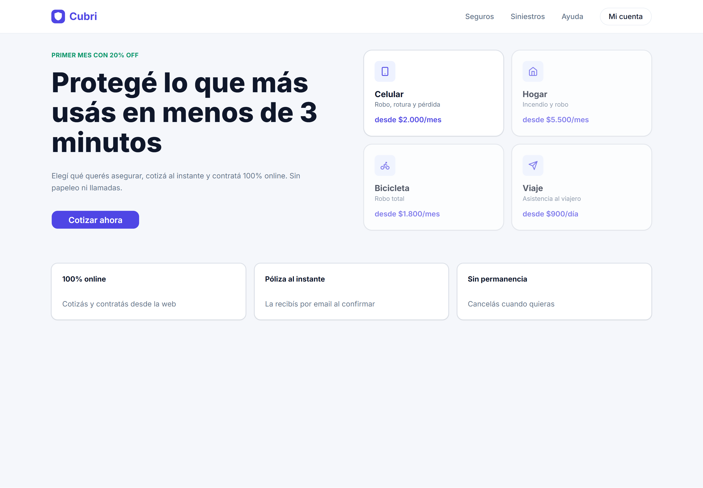
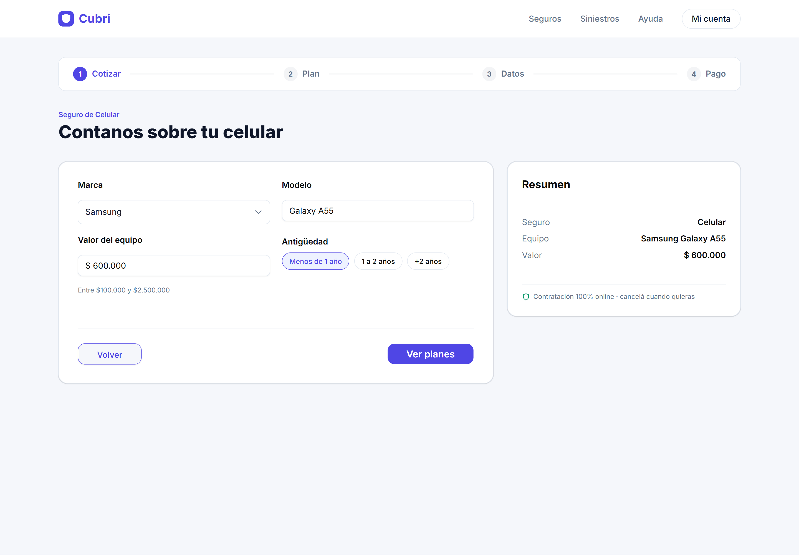
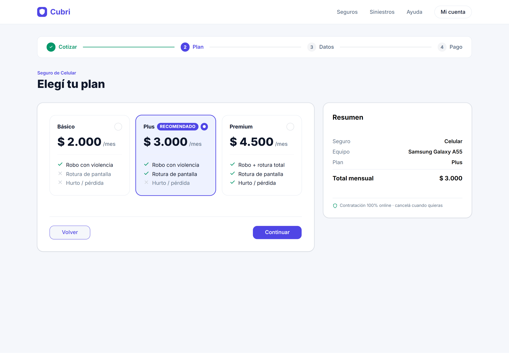
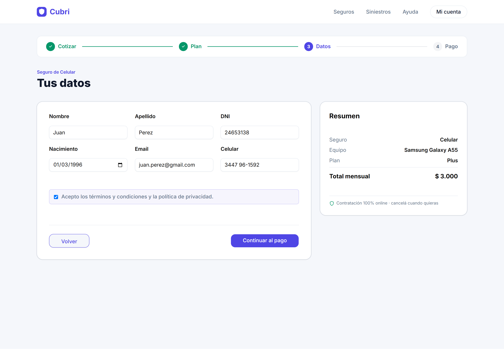
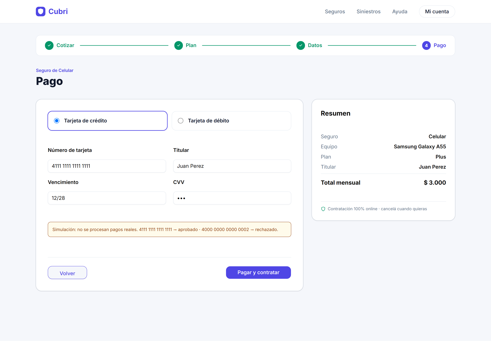
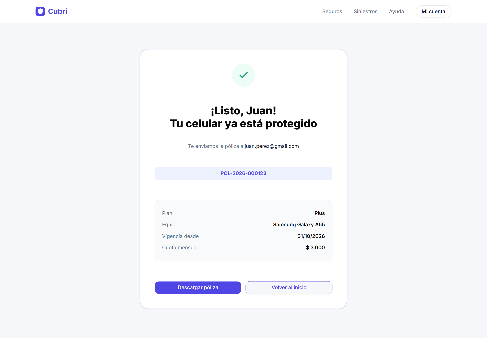
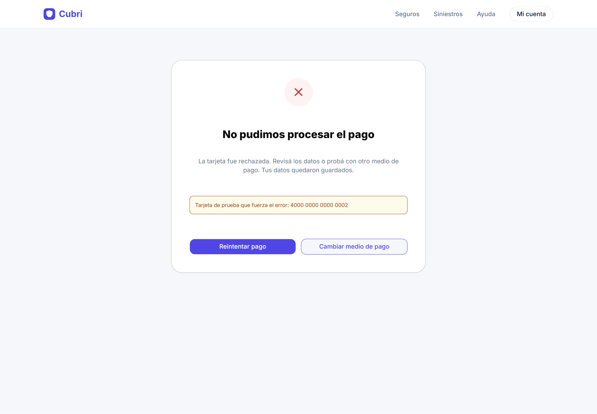

### Versión Móvil (Mobile 390 px)
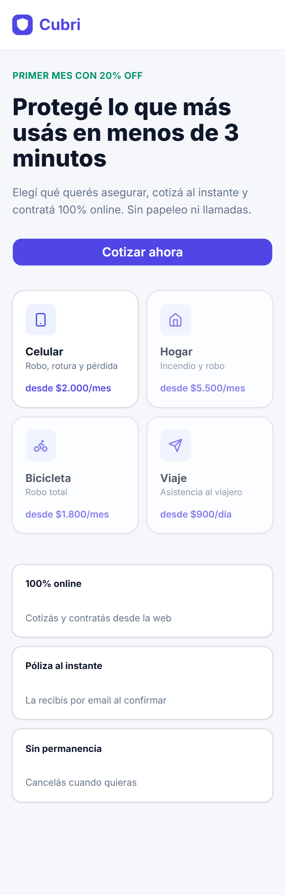
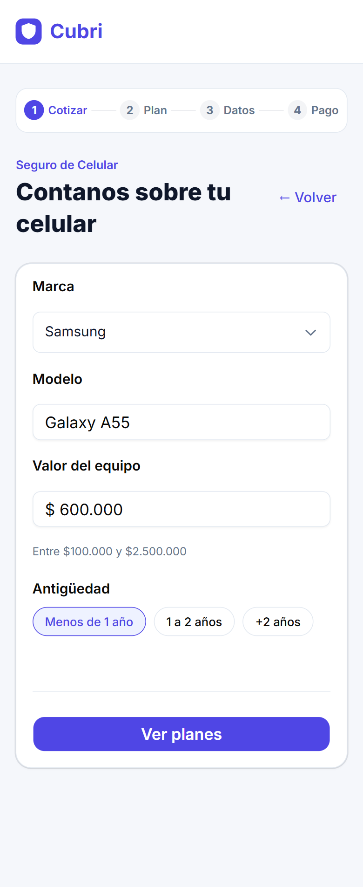
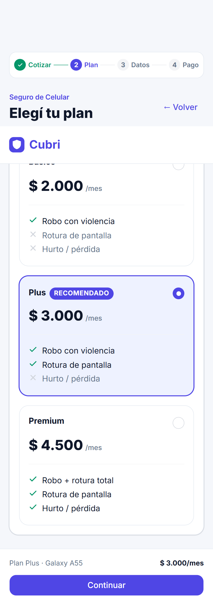
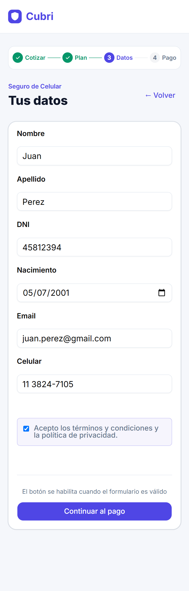
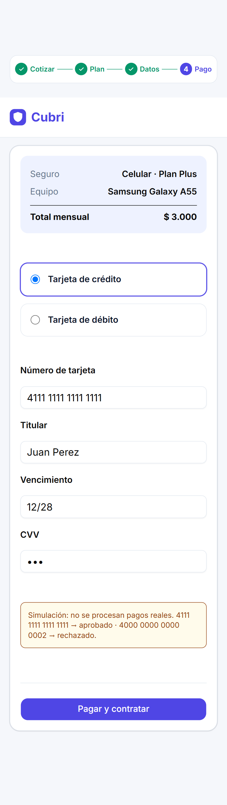
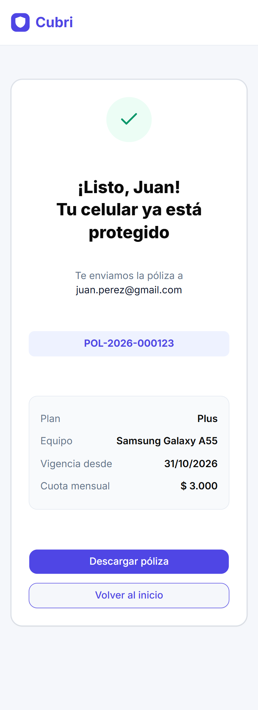
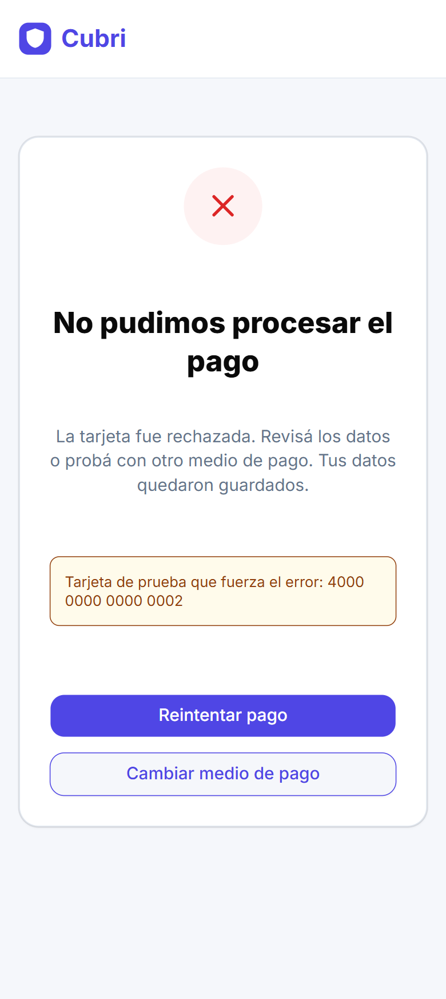