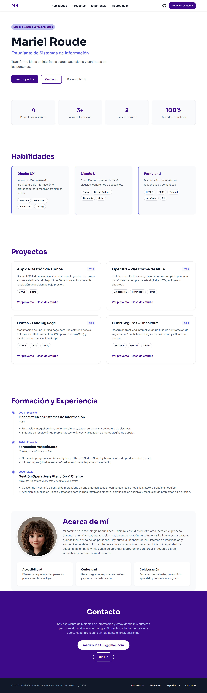
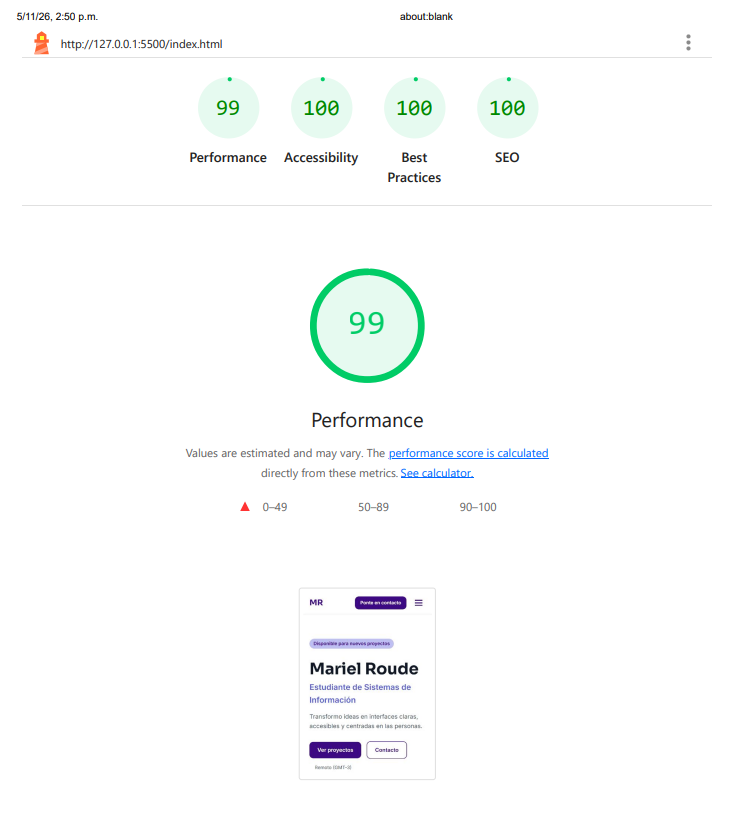

# Portfolio Web Personal - Mariel Roude

Este es mi trabajo final para la materia Diseño UX/UI de la Licenciatura en Sistemas de Información (FCyT).

## Enlaces del Proyecto
- **Sitio en vivo (Netlify):** [https://mariel-roude-portfolio.netlify.app/](https://mariel-roude-portfolio.netlify.app/)
- **Repositorio GitHub:** [https://github.com/Mariel-Roude/Dise-o_UX_UI_2026/tree/main/Trabajo_Final_UXUI_Portfolio_Web](https://github.com/Mariel-Roude/Dise-o_UX_UI_2026/tree/main/Trabajo_Final_UXUI_Portfolio_Web)
- **Prototipo y Proceso UX (Figma):** [Ver diseño en Figma](https://www.figma.com/design/aKbkcuHAcsRi4Q0nJdB9VE/Portfolio-Web---Roude-Mariel?node-id=0-1&t=32a5RNeKTZhlVAnw-1)

## Stack Tecnológico
- **HTML5:** Estructura semántica y accesible.
- **CSS3:** Estilos puros sin frameworks (Variables, Flexbox, Grid, Media Queries).
- **JavaScript Vanilla:** Menú hamburguesa y modales de casos de estudio.
- **Netlify:** Hosting y gestión del formulario de contacto.
- **Git/GitHub:** Control de versiones.

## Proceso UX/UI
El diseño visual y la arquitectura de información se basaron en el objetivo de que un reclutador entienda el perfil, explore el trabajo y encuentre cómo iniciar una conversación.

**Nota de transparencia:** Este documento presenta una propuesta de diseño. El benchmark es un análisis referencial propuesto y los hallazgos del test son ejemplos simulados que ilustran cómo documentar observaciones.

- **Usuario Objetivo:** Reclutador técnico LATAM que evalúa candidaturas de estudiantes.
- **Paleta de colores:** Violeta profundo (#3d0a89), violeta vibrante (#595edc) y lavanda (#bfc0f4).
- **Tipografías:** Sora (títulos) e Inter (cuerpo de texto).
- **Estructura:** One-page accesible con modales nativos para los casos de estudio.

## Política de uso de IA
Se utilizó Inteligencia Artificial como asistente para la estructuración del código. Todo el contenido fue revisado, adaptado y validado.

## Despliegue y CI/CD
El sitio está desplegado en Netlify y conectado a este repositorio.
- Cada `push` a la rama `main` gatilla un despliegue automático.
- El formulario de contacto utiliza **Netlify Forms**.
- Se incluyó una página `404.html` personalizada.

## Capturas del Proyecto

**Vista Desktop:**

 

**Vista Mobile:**

 

**Reporte Lighthouse:**

